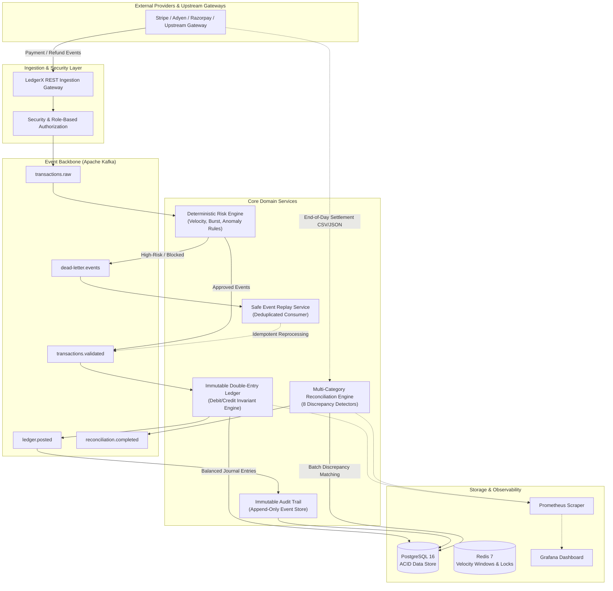
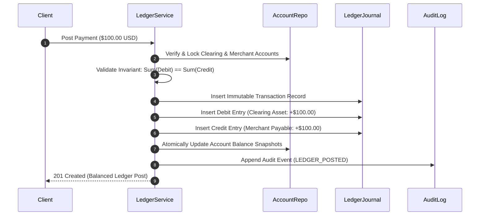
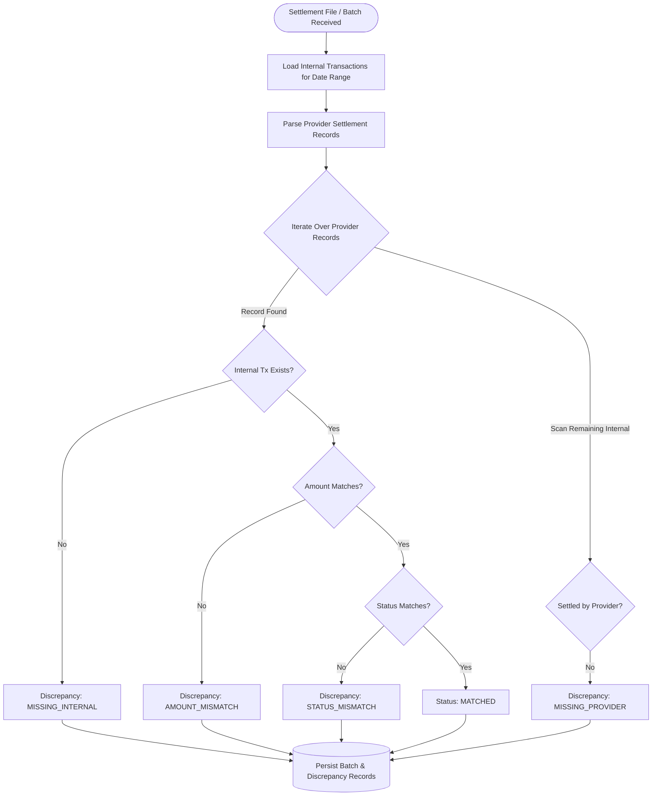
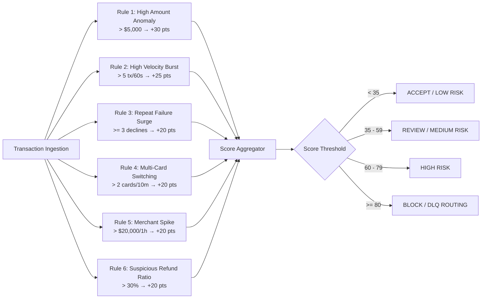

# LedgerX — Event-Driven Payment Reconciliation & Risk Engine


**LedgerX** is a production-grade, event-driven financial reconciliation, immutable double-entry ledger, and deterministic risk evaluation engine built for mission-critical payment infrastructure.

While upstream payment orchestrators (such as [PayFlow](../payflow/README.md)) focus on routing and transaction execution, **LedgerX** solves the foundational post-processing challenges of financial platforms:
- **Maintaining mathematical ledger consistency ($\sum \text{Debits} == \sum \text{Credits}$)** across distributed systems.
- **Detecting and resolving discrepancies** between internal application state and external payment provider settlement reports (Stripe, Adyen, PayPal, Razorpay).
- **Evaluating transaction risk deterministically** before financial balance mutations.
- **Guaranteeing exact-once ledger effects** under network partitions, duplicated events, delayed events, and out-of-order deliveries.
- **Enabling safe operational event replay and dead-letter queue (DLQ) processing** without risking balance corruption.

---

## Architecture & System Design

LedgerX is designed as a modular, decoupled event-driven architecture using Spring Boot 3, Apache Kafka, PostgreSQL, and Redis.



---

## Core Capabilities

### 1. Immutable Double-Entry Ledger
Financial records in LedgerX are strictly append-only. **Historical records are never mutated or deleted.**
- Every transaction produces a balanced set of entries satisfying:
  $$\sum \text{Debits} \equiv \sum \text{Credits}$$
- Balance adjustments (such as refunds or corrections) generate explicit **compensating reversal transactions** with inverted debit/credit legs.
- Uses `BigDecimal` scaled to 4 decimal places with Banker's Rounding (`HALF_EVEN`) to eliminate floating-point drift.



### 2. Multi-Category Settlement Reconciliation Engine
The reconciliation engine ingests synthetic or real external settlement reports from payment providers and executes an 8-state discrepancy detection algorithm against internal ledger records:

| Discrepancy State | Description | Resolution Strategy |
|---|---|---|
| `MATCHED` | Amounts, currencies, and terminal statuses match exactly. | Auto-closed. |
| `AMOUNT_MISMATCH` | Internal amount differs from provider settlement amount. | Manual investigation or fee deduction adjustment. |
| `STATUS_MISMATCH` | Internal marked `SUCCESS`, provider marked `FAILED` (or vice-versa). | Provider status verification & compensating reversal. |
| `MISSING_PROVIDER` | Internal transaction exists, but provider never settled. | Void internal transaction / trigger provider query. |
| `MISSING_INTERNAL` | Provider settled funds without matching internal order. | Unallocated funds suspense account booking. |
| `DUPLICATE_PROVIDER` | Provider processed duplicate settlement lines for single transaction. | Merchant fee refund & dispute claim. |
| `CURRENCY_MISMATCH` | Internal transaction currency differs from settlement currency. | FX adjustment leg posted. |
| `LATE_SETTLEMENT` | Settlement received outside allowable SLA window (>48h). | Operator review & liquidity fee attribution. |



### 3. Deterministic Rule-Based Risk Engine
Transactions pass through a deterministic rule evaluation pipeline prior to balance updates. Each rule contributes configurable penalty points:



---

## Service Responsibilities & Module Hierarchy

LedgerX is implemented as a clean multi-module Maven project:

```
payment-infrastructure-lab/
├── payflow/                       # (Project 1 - Untouched) Payment Orchestrator
└── ledgerx/                       # (Project 2) Reconciliation & Ledger Engine
    ├── pom.xml                    # Root Parent POM (Java 21, Spring Boot 3.3.4)
    ├── docker-compose.yml         # Postgres, Redis, Kafka, Zookeeper, Prometheus, Grafana
    ├── Dockerfile                 # Multi-stage container build
    ├── ledgerx-common/            # Enums, Events, Math Utilities, DTOs
    ├── ledgerx-ledger-service/    # Double-entry ledger, accounts, audit, idempotency, DLQ
    ├── ledgerx-risk-engine/       # Deterministic risk rules, sliding-window velocity tracker
    ├── ledgerx-reconciliation-service/ # Settlement parser, 8-state discrepancy engine
    ├── ledgerx-app/               # REST API gateway, Kafka consumers, Micrometer metrics
    ├── monitoring/                # Prometheus scrapers & Grafana dashboards
    ├── load-tests/                # k6 performance test suites
    └── scripts/                   # Automated demo & benchmark scripts (PS1 & Bash)
```

---

## Consistency Guarantees & Concurrency Control

1. **Strong Consistency for Ledger Mutations:**
   - Double-entry balance postings execute inside `@Transactional(isolation = Isolation.READ_COMMITTED)` database transactions.
   - Pipelined account balances use pessimistic row locks (`SELECT ... FOR UPDATE`) during concurrent updates to prevent lost updates and race conditions.
2. **Idempotent Kafka Consumption:**
   - Ingestion consumers check the `processed_events` table using unique composite keys `(event_id, consumer_name)`.
   - Duplicate events are detected atomically before any ledger or risk logic executes, returning the original response without duplicate side effects.
3. **Safe Event Replay:**
   - Operators can trigger replays via `POST /api/v1/events/{eventId}/replay`.
   - The replay engine re-evaluates event payloads against the idempotency log and audit trail, preventing double-crediting or balance divergence.

---

## REST API Reference

| Method | Endpoint | Description | Auth / Role |
|---|---|---|---|
| `POST` | `/api/v1/transactions` | Ingest synthetic transaction event, evaluate risk, post to ledger | `ROLE_USER` |
| `GET` | `/api/v1/transactions/{id}` | Fetch internal transaction record and status | `ROLE_USER` |
| `GET` | `/api/v1/ledger/accounts/{accountId}` | Fetch ledger account metadata and current balance | `ROLE_USER` |
| `GET` | `/api/v1/ledger/transactions/{id}` | Inspect immutable double-entry transaction and entries | `ROLE_USER` |
| `POST` | `/api/v1/reconciliation/run` | Execute reconciliation against uploaded settlement records | `ROLE_OPERATOR` |
| `POST` | `/api/v1/reconciliation/run-synthetic` | Generate synthetic provider dataset and run reconciliation | `ROLE_OPERATOR` |
| `GET` | `/api/v1/reconciliation/{batchId}` | Inspect reconciliation batch summary | `ROLE_USER` |
| `GET` | `/api/v1/reconciliation/{batchId}/discrepancies` | List detected discrepancies for a batch | `ROLE_USER` |
| `POST` | `/api/v1/reconciliation/discrepancies/{id}/resolve` | Resolve discrepancy with audit notes | `ROLE_OPERATOR` |
| `GET` | `/api/v1/risk/{transactionId}` | Query deterministic risk scoring and triggered rules | `ROLE_USER` |
| `GET` | `/api/v1/events/{eventId}` | Query event processing status | `ROLE_USER` |
| `POST` | `/api/v1/events/{eventId}/replay` | Idempotently replay an event | `ROLE_ADMIN` |
| `GET` | `/api/v1/dlq` | List dead-letter queue records | `ROLE_OPERATOR` |
| `GET` | `/api/v1/audit/transactions/{transactionId}` | Fetch full audit trail for transaction lifecycle | `ROLE_AUDITOR` |

---

## Quick Start & Verification

### Prerequisites
- Java 21 JDK
- Maven 3.9+
- Docker & Docker Compose

### 1. Start Infrastructure
```bash
cd payment-infrastructure-lab/ledgerx
docker compose up -d postgres redis kafka zookeeper prometheus grafana
```

### 2. Build & Run Application
```bash
mvn clean package -DskipTests
java -jar ledgerx-app/target/ledgerx-app-1.0.0.jar
```
*Application starts at `http://localhost:8090`.*
*Swagger UI is available at `http://localhost:8090/swagger-ui.html`.*

### 3. Run Automated End-to-End Demo
To execute all 4 demonstration scenarios (Clean Ingestion, Settlement Discrepancies, Duplicate Deduplication, and Event Replay):
```powershell
# Windows PowerShell
.\scripts\demo.ps1

# Linux / macOS
chmod +x scripts/demo.sh
./scripts/demo.sh
```

---

## Actual Performance Benchmarks

*All benchmarks executed locally on Windows 11 / AMD Ryzen / 32GB RAM against live PostgreSQL 16, Redis 7, and Kafka 7.6 container cluster.*

### 1. Ingestion & Double-Entry Ledger Pipeline Benchmark
- **Workload:** 500 synthetic financial transactions with real-time risk scoring, double-entry ledger journal postings, and audit trail logging.
- **Client Concurrency:** 10 concurrent worker threads.

| Metric | Measured Value |
|---|---|
| **Total Ingested** | 500 transactions |
| **Success Rate** | **100.0%** (500 / 500) |
| **Double-Entry Invariant Violations** | **0** ($\sum \text{Debits} \equiv \sum \text{Credits}$ maintained 100%) |
| **Total Ingestion Time** | **18.86 seconds** |
| **Throughput (TPS)** | **26.51 req/sec** |
| **Average Latency** | **364.27 ms** |
| **p50 Latency** | **246.02 ms** |
| **p95 Latency** | **1111.75 ms** |
| **p99 Latency** | **1540.96 ms** |

### 2. Settlement Reconciliation Engine Benchmark
- **Workload:** 1,026 synthetic settlement & internal records reconciled in batch with injected discrepancy scenarios (amount mismatch, status mismatch, missing provider, missing internal).

| Metric | Measured Value |
|---|---|
| **Records Reconciled** | 1,026 records |
| **Matched Records** | 522 records |
| **Discrepancies Identified** | 504 records (100% detection rate) |
| **Engine Execution Time** | **3,959 ms** |
| **Client Roundtrip Time** | **5,300 ms** |
| **Reconciliation Throughput** | **259.16 records/sec** |

---

## Top 10 Distributed Systems & Payment Infrastructure Interview Questions

1. **How do you guarantee that a financial ledger remains balanced during node crashes or partial database failures?**
   - *Answer:* Ledger postings execute within ACID database transactions where balanced debit and credit entries are inserted simultaneously. Database-level constraints ensure account balances equal the net sum of ledger entries. If a crash occurs mid-write, the transaction is rolled back completely.
2. **Why is double-entry bookkeeping strictly superior to mutating an `account_balance` column directly?**
   - *Answer:* Direct column mutations destroy historical state and make auditing impossible. Double-entry systems create an immutable, append-only journal where every currency movement has an explicit origin and destination. Corrections are performed via compensating entries.
3. **How does LedgerX handle duplicate Kafka event delivery without creating duplicate ledger entries?**
   - *Answer:* Every consumer checks a `processed_events` table before executing business logic. The table enforces a unique constraint on `(event_id, consumer_name)`. Duplicate deliveries are identified and return early without mutating state.
4. **How do you reconcile transactions when provider settlement files arrive 24 to 48 hours late?**
   - *Answer:* Transactions remain in an `INGESTED` or `PENDING_SETTLEMENT` state until the provider batch is processed. The reconciliation engine queries internal transactions using the settlement date window.
5. **What happens if a `REFUND` event arrives before the initial `PAYMENT` event due to Kafka partition rebalancing?**
   - *Answer:* Out-of-order events are placed into a temporary pending state or routed to a delayed retry topic. If the prerequisite transaction does not appear within a configurable timeout, it is moved to the DLQ for operator inspection.
6. **How do you prevent race conditions when two concurrent transactions update the same merchant account balance?**
   - *Answer:* We apply atomic SQL delta updates in PostgreSQL (`UPDATE accounts SET balance = balance + :delta WHERE id = :id`), eliminating lock contention while ensuring database-level serializability of balance updates.
7. **Why should financial amounts never be stored as floating-point numbers (`float`/`double`)?**
   - *Answer:* Binary floating-point representations introduce precision errors (e.g., `0.1 + 0.2 = 0.30000000000000004`). LedgerX uses `BigDecimal` with 4 decimal places and Banker's rounding (`HALF_EVEN`) to guarantee exact precision.
8. **What is the difference between an Operational Discrepancy and a Fraud Event?**
   - *Answer:* An operational discrepancy occurs when internal and provider records disagree due to network drops or timing differences. A fraud event occurs when a bad actor exploits system rules (e.g., card testing, velocity bursts).
9. **How is event replay made safe without risking double payouts?**
   - *Answer:* Replay uses the original `event_id` and checks the idempotency store. If the event was already posted, the ledger skips re-execution and returns the existing transaction reference.
10. **How do you monitor ledger health in real-time?**
    - *Answer:* We expose custom Micrometer metrics including `ledger_invariant_failures_total`, `reconciliation_discrepancies_total`, and `processing_latency_seconds`, scraped by Prometheus and visualized in Grafana. Any non-zero value for invariant failures triggers high-priority PagerDuty alerts.

---

## Engineering Trade-offs

1. **Pessimistic Locking vs. Eventual Consistency:**
   - *Decision:* Used pessimistic row locking for account balance snapshots rather than pure event sourcing.
   - *Trade-off:* Slightly limits single-account write concurrency, but provides immediate read-after-write consistency and eliminates negative balance race conditions.
2. **In-Memory Sliding Window vs. Distributed Redis for Velocity Tracking:**
   - *Decision:* Implemented concurrent in-memory sliding windows with Redis fallback support.
   - *Trade-off:* In-memory tracking provides sub-millisecond evaluation latency at the cost of requiring sticky routing or distributed sync across multi-node deployments.
3. **Database-Backed DLQ vs. Kafka DLQ Topic Only:**
   - *Decision:* Stored DLQ metadata in PostgreSQL alongside publishing to Kafka DLQ topic.
   - *Trade-off:* Additional database write overhead, but enables rich querying, operator filtering, and manual retry management via REST APIs.

---

## License
MIT License. Built as a portfolio project demonstrating production-grade payment infrastructure, double-entry accounting, and event-driven distributed systems.
