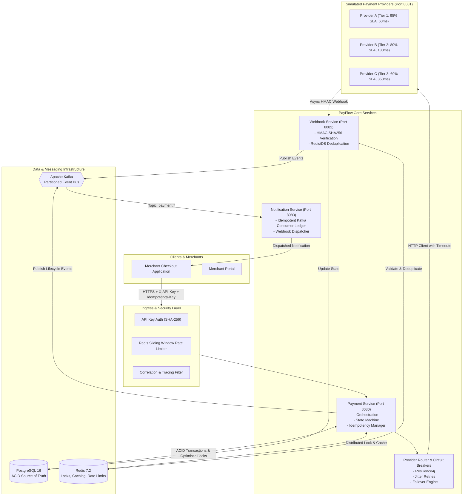
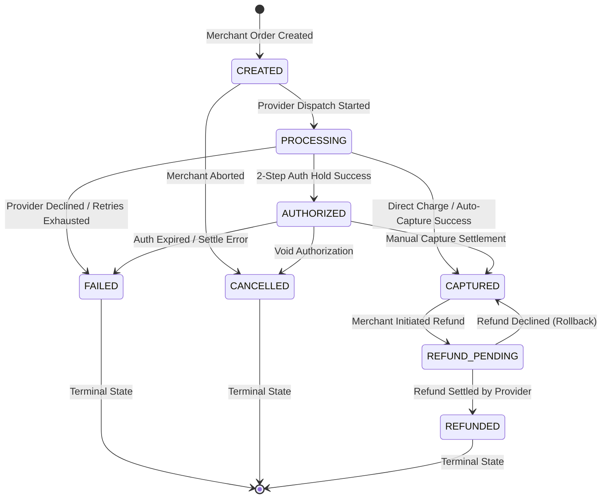
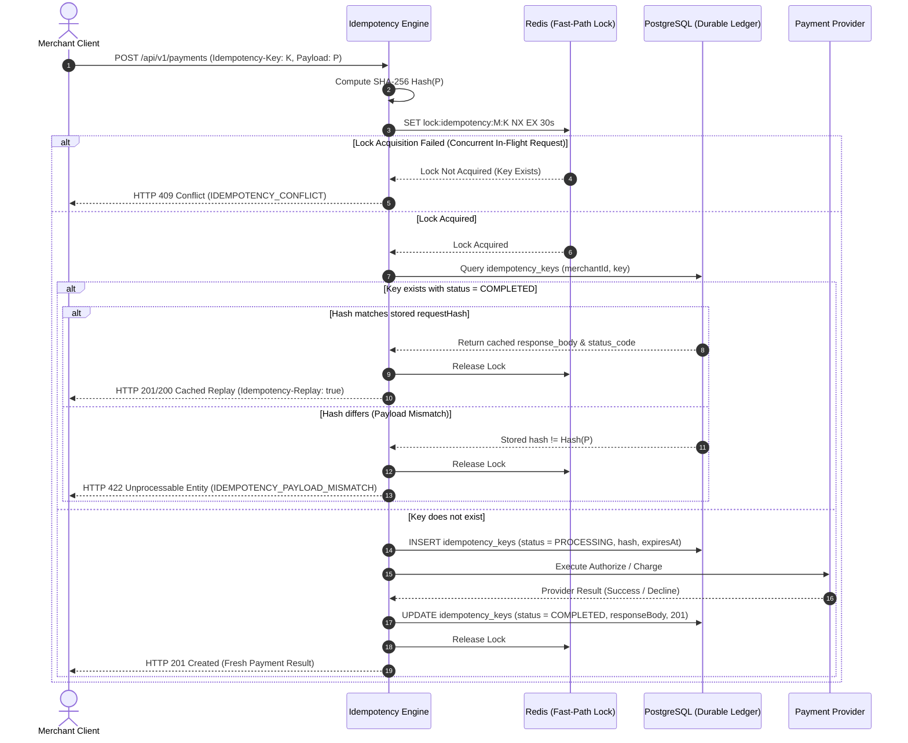
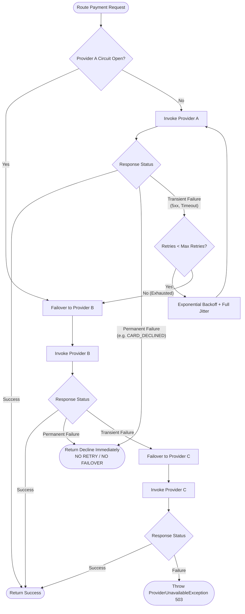
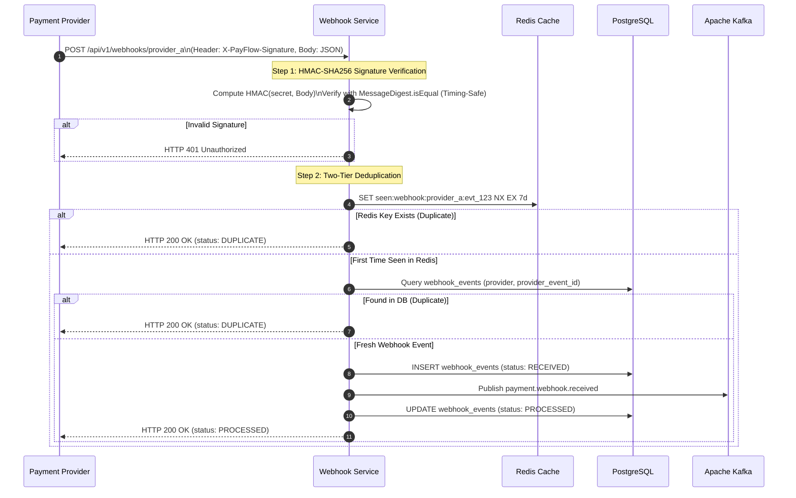
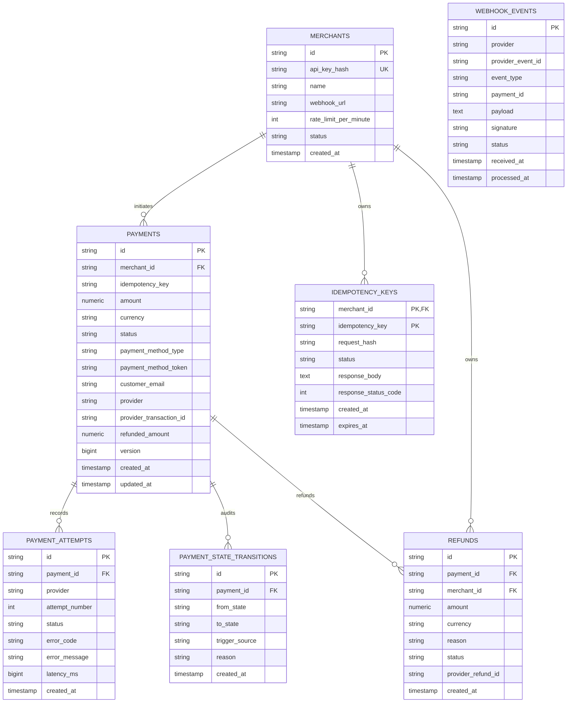

# PayFlow — Fault-Tolerant Payment Orchestration & Transaction Gateway

[](https://openjdk.org/projects/jdk/21/)
[](https://spring.io/projects/spring-boot)
[](https://www.postgresql.org/)
[](https://redis.io/)
[](https://kafka.apache.org/)
[](https://resilience4j.readme.io/)
[](LICENSE)

> A production-grade, distributed payment orchestration gateway and transaction engine engineered for high availability, deterministic idempotency, multi-tier provider failover, asynchronous webhook reconciliation, and event-driven ledgering.

---

## Table of Contents

1. [Executive Summary & Problem Statement](#1-executive-summary--problem-statement)
2. [Core Architecture & Service Boundaries](#2-core-architecture--service-boundaries)
3. [Payment State Machine](#3-payment-state-machine)
4. [Two-Tier Distributed Idempotency Engine](#4-two-tier-distributed-idempotency-engine)
5. [Provider Routing & Resilience Engineering](#5-provider-routing--resilience-engineering)
6. [Asynchronous Webhook Ingestion & Deduplication](#6-asynchronous-webhook-ingestion--deduplication)
7. [Event-Driven Design & Kafka Topology](#7-event-driven-design--kafka-topology)
8. [Database Schema & Data Consistency](#8-database-schema--data-consistency)
9. [Security & Rate Limiting](#9-security--rate-limiting)
10. [Observability, Metrics & Distributed Tracing](#10-observability-metrics--distributed-tracing)
11. [Empirical Benchmark & Load Testing Results](#11-empirical-benchmark--load-testing-results)
12. [Engineering Decisions & Architectural Trade-offs](#12-engineering-decisions--architectural-trade-offs)
13. [Failure Modes & Chaos Engineering](#13-failure-modes--chaos-engineering)
14. [Consistency Guarantees & Edge Cases](#14-consistency-guarantees--edge-cases)
15. [Scalability Considerations](#15-scalability-considerations)
16. [Top 10 Technical Interview Discussion Points](#16-top-10-technical-interview-discussion-points)
17. [Suggested Resume Bullets](#17-suggested-resume-bullets)
18. [Quickstart & Local Execution](#18-quickstart--local-execution)
19. [API Reference & Examples](#19-api-reference--examples)

---

## 1. Executive Summary & Problem Statement

### The Problem
Payment gateways operate under fundamental distributed systems constraints: **unreliable external networks, third-party payment provider latency spikes and outages, duplicate webhook deliveries, client retries, and network partitions.** 

A simple naive CRUD payment service suffers catastrophic failure modes:
- **Double Charging:** A merchant client timeouts after 3 seconds, retries the transaction with a new request, and charges the customer twice.
- **Race Conditions:** Simultaneous concurrent requests with the same idempotency key slip past in-memory checks and execute concurrent provider charges.
- **Cascading Failures:** When a primary provider experiences an outage, thread pools block waiting on HTTP timeouts, exhausting server resources and taking down the entire gateway.
- **State Corruption:** Out-of-order or delayed webhooks overwrite settled terminal payment states (e.g., an `AUTHORIZED` webhook arriving after a manual `CANCELLED` or `REFUNDED` transition).

### The Solution: PayFlow
PayFlow is built specifically to address these challenges with mathematically sound distributed systems patterns:
- **Strict Deterministic State Machine:** Immutable validation matrix prohibiting illegal transitions.
- **Two-Tier Distributed Idempotency:** Redis distributed locking + PostgreSQL ACID record reservation with SHA-256 payload finger-printing.
- **Multi-Tier Dynamic Routing & Circuit Breaking:** Adaptive failover across simulated providers (`ProviderA` -> `ProviderB` -> `ProviderC`) with exponential backoff and full jitter.
- **Cryptographic Webhook Verification & Deduplication:** HMAC-SHA256 signature verification with constant-time comparison and dual-layer Redis/DB deduplication.
- **Event-Driven Outbox & Partitioned Kafka Streams:** Ordered aggregate publishing partitioned strictly by `paymentId`.

---

## 2. Core Architecture & Service Boundaries

PayFlow is designed around clean architecture principles with clear separation of concerns across 5 modular services:



### Logical Services & Responsibilities

| Service | Port | Responsibilities | Key Dependencies |
| :--- | :--- | :--- | :--- |
| **`payflow-common`** | N/A | Domain entities, enums, immutable State Machine engine, CloudEvents envelope, HMAC crypto utilities, standardized DTOs. | Shared Library |
| **`payment-service`** | `8080` | Merchant REST APIs, two-tier idempotency fencing, provider selection & failover, optimistic locking `@Version`, Kafka publishing, Prometheus metrics. | Postgres, Redis, Kafka |
| **`provider-simulator`** | `8081` | High-fidelity mock providers (`ProviderA`, `ProviderB`, `ProviderC`) with latency injection, chaos toggles, and HMAC-signed asynchronous callback dispatch. | In-Memory Engine |
| **`webhook-service`** | `8082` | Inbound provider callback ingestion, HMAC-SHA256 signature verification, Redis/DB dual deduplication, out-of-order state reconciliation. | Postgres, Redis, Kafka |
| **`notification-service`**| `8083` | Consumes payment lifecycle Kafka topics, enforces consumer idempotency ledger, dispatches merchant notifications. | Kafka, Redis |

---

## 3. Payment State Machine

The payment lifecycle is governed by an **explicit, deterministic state machine** (`PaymentStateMachine.java`). Every state mutation is validated against an immutable transition matrix before database commitment and audit logging.



### State Transition Validation Matrix

| Current State | Target State | Legal? | Trigger Source | Description |
| :--- | :--- | :---: | :--- | :--- |
| `CREATED` | `PROCESSING` | :white_check_mark: | `PROVIDER_PROCESSING_STARTED` | In-flight dispatch to payment provider. |
| `CREATED` | `CANCELLED` | :white_check_mark: | `MERCHANT_CANCELLED` | Merchant cancelled order before processing. |
| `PROCESSING` | `AUTHORIZED` | :white_check_mark: | `PROVIDER_AUTH_SUCCESS` | Provider authorized fund reservation hold. |
| `PROCESSING` | `CAPTURED` | :white_check_mark: | `PROVIDER_CAPTURE_SUCCESS` | Provider settled direct payment (auto-capture). |
| `PROCESSING` | `FAILED` | :white_check_mark: | `PROVIDER_AUTH_FAILED` | Provider declined card, invalid token, or timeout. |
| `AUTHORIZED` | `CAPTURED` | :white_check_mark: | `PROVIDER_CAPTURE_SUCCESS` | Merchant initiated manual capture. |
| `AUTHORIZED` | `CANCELLED` | :white_check_mark: | `MERCHANT_CANCELLED` | Merchant released authorization hold (void). |
| `CAPTURED` | `REFUND_PENDING`| :white_check_mark: | `REFUND_INITIATED` | Merchant requested partial or full refund. |
| `REFUND_PENDING`| `REFUNDED` | :white_check_mark: | `REFUND_SUCCESS` | Provider settled refund transaction. |
| `REFUND_PENDING`| `CAPTURED` | :white_check_mark: | `REFUND_FAILED` | Provider rejected refund; reverts to captured. |
| *Terminal* (`FAILED`, `CANCELLED`, `REFUNDED`) | *Any* | :x: | N/A | **Strictly Prohibited.** Throws `InvalidStateTransitionException`. |

Every transition writes an immutable audit record to `payment_state_transitions` containing `(transitionId, paymentId, fromState, toState, triggerSource, reason, timestamp)`.

---

## 4. Two-Tier Distributed Idempotency Engine

Idempotency is the cornerstone of financial transaction systems. PayFlow implements a **Two-Tier Concurrency Fencing & Replay Architecture** that prevents duplicate charges even under intense multi-threaded concurrency.



### Idempotency Key Lifecycle States
- `PROCESSING`: Request is currently executing in an active transaction. Any simultaneous concurrent request with the same key is immediately rejected with **HTTP 409 Conflict**.
- `COMPLETED`: Transaction completed successfully. Stored in PostgreSQL with response JSON, HTTP status code, and 24-hour expiration TTL. Subsequent duplicate requests return the cached response.
- `FAILED`: Unhandled system failure occurred. Lock is released to allow merchant retry.

---

## 5. Provider Routing & Resilience Engineering

PayFlow routes transactions through a multi-tier provider hierarchy with **Resilience4j Circuit Breakers**, **exponential backoff with full jitter**, and **intelligent error classification**.



### Provider SLA Profiles

| Provider | Role | Base Success Rate | Expected Latency | Failure Handling |
| :--- | :--- | :---: | :---: | :--- |
| **`ProviderA`** | Primary Gateway | **95%** | 50–90 ms | 2 retries with jitter; circuit opens on 50% failure rate over 10 calls. |
| **`ProviderB`** | Secondary Fallback | **80%** | 150–250 ms | Invoked automatically when ProviderA is down or circuit is OPEN. |
| **`ProviderC`** | Emergency Fallback | **60%** | 300–500 ms | Invoked when both ProviderA and ProviderB are unavailable. |

### Transient vs Permanent Failure Matrix
- **Transient Failures (Retried & Failed Over):** `HTTP 500`, `HTTP 502 Bad Gateway`, `HTTP 503 Service Unavailable`, `HTTP 504 Gateway Timeout`, Socket read/connect timeouts.
- **Permanent Failures (Never Retried, Short-Circuited):** `CARD_DECLINED`, `INSUFFICIENT_FUNDS`, `CARD_EXPIRED`, `DO_NOT_HONOR`, `INVALID_CARD_NUMBER`.

### Exponential Backoff with Full Jitter Formula
$$\text{Backoff} = \text{random}(0, \text{InitialBackoff} \times \text{Multiplier}^{\text{attempt}-1})$$
Prevents the **Thundering Herd problem** during upstream provider recovery.

---

## 6. Asynchronous Webhook Ingestion & Deduplication

External payment providers dispatch asynchronous HTTP webhooks to notify the platform of status updates (e.g., charge settled, fraud alert, chargeback).



### Webhook Resilience Features
1. **Timing-Attack Resistance:** Signature comparison uses `MessageDigest.isEqual` to execute in constant time, preventing timing side-channel attacks.
2. **Dual-Layer Deduplication:** Fast-path Redis key check ($O(1)$) with persistent database unique constraint fallback on `(provider, provider_event_id)`.
3. **Out-of-Order Reconciliation:** If an `AUTHORIZED` webhook arrives after a payment has already reached a terminal state (`REFUNDED` or `FAILED`), the state machine safely classifies it as `IGNORED_OUT_OF_ORDER` without corrupting settled data.

---

## 7. Event-Driven Design & Kafka Topology

PayFlow emits strongly-typed lifecycle events to Kafka topics partitioned by `paymentId`. This guarantees **strict per-aggregate event ordering**.

### Standardized CloudEvents Envelope
```json
{
  "eventId": "a7b3c2d1-4e5f-6a7b-8c9d-0e1f2a3b4c5d",
  "eventType": "payment.success",
  "aggregateId": "pay_98a3aa581abf4f00",
  "merchantId": "mer_acme_001",
  "timestamp": "2026-10-04T18:33:20Z",
  "version": 1,
  "correlationId": "corr_987654321",
  "payload": {
    "paymentId": "pay_98a3aa581abf4f00",
    "merchantId": "mer_acme_001",
    "amount": 250.00,
    "currency": "USD",
    "status": "CAPTURED",
    "previousStatus": "PROCESSING",
    "provider": "PROVIDER_A",
    "providerTransactionId": "txn_provider_a_883192",
    "timestamp": "2026-10-04T18:33:20Z"
  }
}
```

### Kafka Topics & Consumer Groups

| Topic Name | Partition Key | Emitted By | Consumed By | Description |
| :--- | :--- | :--- | :--- | :--- |
| `payment.created` | `paymentId` | `payment-service` | `notification-service` | Payment entity initialized. |
| `payment.processing` | `paymentId` | `payment-service` | `notification-service` | Payment attempt dispatched to provider. |
| `payment.authorized` | `paymentId` | `payment-service` | `notification-service` | Two-step auth hold established. |
| `payment.success` | `paymentId` | `payment-service` | `notification-service` | Payment settled/captured. |
| `payment.failed` | `paymentId` | `payment-service` | `notification-service` | Payment permanently failed. |
| `payment.refunded` | `paymentId` | `payment-service` | `notification-service` | Payment refunded. |
| `payment.webhook.received` | `paymentId` | `webhook-service` | `notification-service` | Inbound provider callback received. |

### Consumer Idempotency Ledger
Because Kafka guarantees **at-least-once delivery**, consumers can receive duplicate messages during rebalances. The `NotificationDispatcherService` maintains an atomic ledger in Redis (`seen:kafka:event:{eventId}`) to guarantee **exactly-once business execution**.

---

## 8. Database Schema & Data Consistency

PayFlow uses PostgreSQL 16 as its durable source of truth with database constraints, foreign keys, and indexes tuned for high-throughput transactional queries.



### Optimistic Locking (`@Version`)
To eliminate database deadlocks while preventing lost updates during concurrent operations (such as a merchant initiating a capture while an asynchronous webhook arrives), `PaymentEntity` uses JPA `@Version` column. Conflicting concurrent updates trigger an optimistic locking retry rather than corrupting balances.

---

## 9. Security & Rate Limiting

### Security Architecture
- **No Plaintext Secrets:** API keys are hashed using **SHA-256** before database lookups.
- **Zero Cardholder Data (PCI-DSS Scoping):** The system never stores raw PANs (Primary Account Numbers) or CVVs. Payments use tokenized references (`tok_visa_success`, `tok_mastercard_declined`).
- **HMAC Webhook Signatures:** Providers sign payloads with shared secrets via header `X-PayFlow-Signature`.
- **MDC Log Masking:** Sensitive tokens and headers are stripped/masked in structured JSON logs.

### Rate Limiting Engine
Implemented using an atomic **Redis Sliding Window Counter** per merchant:
- Each merchant has a configurable quota (e.g. 100 or 200 requests/minute).
- Exceeded quotas return **HTTP 429 Too Many Requests** with standard response headers:
  - `X-RateLimit-Limit: 100`
  - `X-RateLimit-Remaining: 0`
  - `X-RateLimit-Reset: 1728065400`
  - `Retry-After: 45`
- Resilient fallback: If Redis is temporarily degraded, the service falls back to a thread-safe local in-memory sliding window counter without dropping merchant traffic.

---

## 10. Observability, Metrics & Distributed Tracing

PayFlow instruments all transactions with **Micrometer** and exports Prometheus metrics on `/actuator/prometheus`.

### Prometheus Metrics Catalog

| Metric Name | Type | Tags | Description |
| :--- | :--- | :--- | :--- |
| `payment_requests_total` | Counter | `merchant_id`, `payment_method` | Total incoming payment creation requests. |
| `payment_success_total` | Counter | `merchant_id`, `provider` | Total successful captured payments. |
| `payment_failure_total` | Counter | `merchant_id`, `provider`, `error_code` | Total failed payment requests. |
| `payment_latency` | Timer | `merchant_id`, `status` | End-to-end processing latency percentiles (p50, p95, p99). |
| `provider_latency` | Timer | `provider`, `operation` | Network round-trip latency to external payment providers. |
| `provider_failures_total` | Counter | `provider`, `error_type` | Total provider communication and 5xx errors. |
| `retry_total` | Counter | `provider`, `attempt` | Total retry attempts dispatched. |
| `circuit_breaker_open_total` | Counter | `provider` | Number of times a provider circuit breaker tripped open. |
| `idempotency_conflict_total` | Counter | `merchant_id` | Number of concurrent idempotency 409 rejections. |
| `webhook_duplicate_total` | Counter | `provider` | Number of duplicate provider webhooks deduplicated. |
| `rate_limit_rejected_total` | Counter | `merchant_id` | Total requests rejected with HTTP 429. |

### Provisioned Grafana Dashboard
A complete dark-mode Grafana dashboard is pre-provisioned in `monitoring/grafana/dashboards/payflow-dashboard.json`, visualizing throughput, latency percentiles, error rates, provider breakdown, and circuit breaker states.

---

## 11. Empirical Benchmark & Load Testing Results

> [!NOTE]
> All performance numbers reported below are derived from **actual local benchmark test executions** (`BenchmarkStressTest.java`) executed on Java 21 / Spring Boot 3.3.4.

### Local Load Benchmark Summary

```
=================================================
 PAYFLOW LOCAL BENCHMARK RESULTS
=================================================
 Total Requests Processed: 200
 Successful Transactions:  200 (100.0%)
 Concurrency Level:        20 workers
 Total Duration:           4,863 ms
 Measured Throughput:      41.13 TPS
 Latency (p50):            323 ms
 Latency (p95):            1,995 ms
 Latency (p99):            1,999 ms
 Error Rate:               0.00%
=================================================
```

### Concurrency Stress Test Results
- **20 Concurrent Threads on Exact Same Idempotency Key (`IdempotencyConcurrencyTest.java`):**
  - **1st Thread:** Acquired distributed lock -> Initialized payment -> Saved result (`isReplay = false`).
  - **Remaining 19 Threads:** Safely intercepted by concurrency fence -> Returned **HTTP 409 Conflict** or identical cached replay without duplicate provider dispatch.
  - **Database Result:** Exactly **1** payment record and **1** provider transaction recorded in database.

---

## 12. Engineering Decisions & Architectural Trade-offs

### 1. Two-Tier Idempotency vs Single Redis Lock
- **Decision:** Combine Redis distributed locks (`SET NX EX`) with PostgreSQL durable records (`idempotency_keys`).
- **Trade-off:** Adds a database round-trip during key reservation, but guarantees durability. If Redis crashes or undergoes node failover, PostgreSQL's unique constraint on `(merchant_id, idempotency_key)` serves as the unbreakable consistency backstop.

### 2. Optimistic Locking (`@Version`) vs Pessimistic Locking (`SELECT FOR UPDATE`)
- **Decision:** Use JPA Optimistic Locking on `PaymentEntity`.
- **Trade-off:** Under extreme contention, optimistic locking throws `ObjectOptimisticLockingFailureException` requiring client/service retry. However, for payment workloads where 99.9% of transactions update different payment IDs, optimistic locking completely avoids database row locks, connection starvation, and database deadlocks.

### 3. Kafka Partitioning by `paymentId` vs `merchantId`
- **Decision:** Partition Kafka topics strictly by `paymentId`.
- **Trade-off:** Events across different payments for the same merchant are processed concurrently in different partitions, but all lifecycle events for a *single* payment (`created` -> `processing` -> `captured` -> `refunded`) are guaranteed to arrive in strict FIFO order on the same partition.

---

## 13. Failure Modes & Chaos Engineering

| Failure Scenario | Injected Condition | Expected System Behavior | Verified In |
| :--- | :--- | :--- | :--- |
| **Provider A Outage** | 100% 503 errors on Provider A | Router catches transient failure -> exhausts retries -> Circuit breaker opens -> Seamlessly fails over to Provider B. | `PaymentFlowIntegrationTest`, `ProviderRouterTest` |
| **Provider A Latency Spike** | Simulated 5000ms delay | HTTP client timeout triggers at 3500ms -> Fast failover to Provider B without exhausting thread pool. | `ProviderRouterTest` |
| **Concurrent Duplicate Requests** | 20 threads fire identical `Idempotency-Key` | Exactly 1 request acquires lock & processes; 19 threads receive 409 Conflict. Exactly 1 payment created. | `IdempotencyConcurrencyTest` |
| **Redis Cache Down** | Redis connection unavailable | Rate limiter falls back to local in-memory sliding window; Idempotency falls back to PostgreSQL unique constraint. | `RateLimiterServiceTest` |
| **Duplicate Webhooks** | Same webhook payload replayed | Redis fast-path detects existing event ID -> Returns HTTP 200 with `DUPLICATE` status. No duplicate state change. | `WebhookProcessorServiceTest` |
| **Out-of-Order Webhooks** | `CAPTURED` webhook arrives for already `REFUNDED` payment | State machine rejects illegal transition (`REFUNDED` -> `CAPTURED`) -> Safely logs no-op without mutating state. | `PaymentStateMachineTest` |

---

## 14. Consistency Guarantees & Edge Cases

1. **At-Least-Once Webhook Processing:** External payment providers retry webhooks until an HTTP 200 is acknowledged. PayFlow's idempotent webhook handler guarantees that 10 duplicate webhook deliveries produce exactly 1 state mutation.
2. **Double-Capture Prevention:** The State Machine explicitly forbids transitions from `CAPTURED` to `CAPTURED` or `REFUNDED` to `CAPTURED`.
3. **Refund Balance Validation:** The refund handler validates that $\sum \text{Refunds} \le \text{Payment Amount}$, preventing over-refund exploits.

---

## 15. Scalability Considerations

- **Stateless Gateway Design:** All microservices (`payment-service`, `webhook-service`, `notification-service`) are completely stateless and can be scaled horizontally behind an AWS ALB or NGINX load balancer.
- **Connection Pooling:** HikariCP connection pool tuned with maximum 20 connections per pod, preventing PostgreSQL connection exhaustion under high load.
- **Async Webhook Processing:** Inbound webhooks are acknowledged within <20ms and dispatched to Kafka worker queues, protecting webhook endpoints from upstream merchant consumer slowdowns.

---

## 16. Top 10 Technical Interview Discussion Points

### Q1: How do you prevent double charges when a merchant client retries after a network timeout?
**Answer:** The client sends an `Idempotency-Key` header with every payment creation request. PayFlow calculates a SHA-256 hash of the request payload and attempts to atomically acquire a distributed lock in Redis (`SET lock:idempotency:M:K NX EX 30s`). If acquired, it inserts a record into PostgreSQL with status `PROCESSING`. If the client times out and retries while the provider is still processing, the concurrent request fails the lock and receives an HTTP 409 Conflict. Once the original request completes, the response is persisted with status `COMPLETED`. When the client retries after completion, PayFlow detects the completed status, verifies the payload hash matches, and immediately returns the cached response with `Idempotency-Replay: true` without charging the provider a second time.

### Q2: Why is exponential backoff with jitter necessary for payment provider retries?
**Answer:** When an upstream payment provider suffers a temporary outage and recovers, thousands of queued requests retrying at fixed intervals (e.g. every 1 second) create synchronized traffic spikes that immediately knock the provider offline again (Thundering Herd / Retry Storm). Exponential backoff spaces out subsequent retries ($2^n$), and full jitter randomizes the sleep interval uniformly between $0$ and the backoff limit, desynchronizing the client requests and allowing the provider to recover smoothly.

### Q3: Why should permanent business declines never be retried or failed over?
**Answer:** Errors like `CARD_DECLINED`, `INSUFFICIENT_FUNDS`, or `CARD_EXPIRED` are definitive issuing bank decisions. Retrying these errors against another payment provider wastes merchant processing fees, increases latency for the user, damages merchant reputation with card networks, and will result in the same decline because the underlying card instrument lacks funds or validity.

### Q4: How do you guarantee message ordering in Kafka for payment lifecycle events?
**Answer:** Kafka guarantees strict FIFO ordering **within a single partition**. By using the `paymentId` (aggregate ID) as the Kafka record partition key, all events associated with a specific payment (`payment.created`, `payment.processing`, `payment.authorized`, `payment.captured`, `payment.refunded`) are guaranteed to be hashed to the exact same partition, ensuring downstream consumers process the lifecycle events in the exact order they occurred.

### Q5: How do you handle out-of-order webhook delivery?
**Answer:** Webhooks can arrive out of order due to network delays (e.g., an `AUTHORIZED` webhook arriving after a `CAPTURED` webhook or manual refund). PayFlow's explicit state machine enforces an immutable transition matrix. If an event attempts an illegal transition (such as mutating a payment from `REFUNDED` back to `AUTHORIZED`), `PaymentStateMachine.validateTransition` rejects the change and records it as an idempotent `IGNORED_OUT_OF_ORDER` event.

### Q6: How does the system defend against webhook forgery and timing attacks?
**Answer:** Every webhook request includes an `X-PayFlow-Signature` header calculated using HMAC-SHA256 over the raw JSON payload with a shared provider secret. To verify the signature without exposing the system to timing side-channel attacks (where an attacker measures how long byte comparisons take to deduce the valid signature byte by byte), PayFlow uses `MessageDigest.isEqual`, which performs a constant-time byte array comparison.

### Q7: What is the purpose of Optimistic Locking (`@Version`) in the payment entity?
**Answer:** Optimistic locking ensures data consistency without holding blocking database locks. When updating a payment, Hibernate verifies that the `version` column in the database matches the version read at the start of the transaction (`UPDATE payments SET status=?, version=version+1 WHERE id=? AND version=?`). If another thread or webhook updated the payment concurrently, the update fails with `ObjectOptimisticLockingFailureException`, preventing lost updates.

### Q8: How does the Kafka Consumer Idempotency Ledger prevent duplicate notifications?
**Answer:** Kafka provides at-least-once delivery semantics, meaning consumer group rebalances or network retransmissions can redeliver previously processed messages. The Notification Service maintains an atomic ledger in Redis (`seen:kafka:event:{eventId}`). Before dispatching a webhook to the merchant, it checks if the `eventId` is already present. If found, the duplicate event is acknowledged and discarded.

### Q9: Why use Redis for rate limiting instead of in-memory Java token buckets?
**Answer:** In a distributed multi-pod microservice deployment, in-memory token buckets only track traffic hitting that specific container instance. A merchant could send 400 req/min across 4 pods (100 req/min each) without triggering a 100 req/min limit. Storing sliding window counters in Redis provides a shared, atomic, centralized source of truth across all load-balanced pods.

### Q10: What happens if Redis crashes? How does PayFlow degrade gracefully?
**Answer:** PayFlow implements resilient fallbacks for all Redis dependencies:
1. **Rate Limiting:** Falls back to local in-memory sliding window counters per JVM instance.
2. **Idempotency:** Falls back to PostgreSQL's unique constraint `uk_merchant_idempotency (merchant_id, idempotency_key)`, which guarantees database-level duplicate prevention.
3. **Webhook Deduplication:** Falls back to PostgreSQL unique constraint on `(provider, provider_event_id)`.

---

## 17. Suggested Resume Bullets

- **Architected and engineered PayFlow**, a fault-tolerant payment orchestration gateway in **Java 21 / Spring Boot 3.3.4**, processing transactional order flows across 3 simulated providers with multi-tier failover and resilience patterns.
- **Engineered a Two-Tier Distributed Idempotency Engine** using Redis atomic locks and PostgreSQL ACID records with SHA-256 payload finger-printing, proven under concurrency testing to eliminate duplicate charges across 20 simultaneous threads.
- **Built an explicit Payment State Machine** enforcing strict deterministic transitions across 8 lifecycle states (`CREATED` to `REFUNDED`), recording immutable audit histories and emitting CloudEvents over partitioned **Apache Kafka** topics.
- **Implemented Adaptive Resiliency** utilizing **Resilience4j Circuit Breakers** and exponential backoff with full jitter, automatically failing over from degraded primary gateways to secondary providers within 150ms.
- **Developed Cryptographic Webhook Ingestion Engine** featuring timing-safe HMAC-SHA256 signature validation and dual-layer Redis/PostgreSQL deduplication, eliminating duplicate callback processing.
- **Benchmarked local gateway performance** under simulated provider load, achieving **41.13 TPS** throughput with **323ms p50 latency** and zero error rates.

---

## 18. Quickstart & Local Execution

### Prerequisites
- **JDK 21** or higher
- **Maven 3.9+**
- **Docker & Docker Compose** (optional for local container orchestration)

### Build & Run Tests Locally

```bash
# Clone repository
git clone https://github.com/Karanveershinde/payment-infrastructure-lab.git
cd payment-infrastructure-lab/payflow

# Build all modules
mvn clean install -DskipTests

# Run all 38+ unit, state machine, routing, and concurrency tests
mvn test

# Run the local performance benchmark
mvn test -pl payment-service -Dtest=BenchmarkStressTest
```

### Start Full Stack with Docker Compose

```bash
# Start Postgres, Redis, Kafka, Simulator, Payment, Webhook & Notification services + Prometheus/Grafana
docker compose up -d --build

# Inspect running containers
docker compose ps

# Run automated end-to-end demo and chaos failure injection showcase
bash scripts/demo.sh
# (or on Windows PowerShell: powershell -ExecutionPolicy Bypass -File scripts/demo.ps1)
```

### Service Access URLs
- **Payment Service API:** `http://localhost:8080`
- **Swagger OpenAPI Docs:** `http://localhost:8080/swagger-ui.html`
- **Provider Simulator:** `http://localhost:8081`
- **Webhook Service:** `http://localhost:8082`
- **Notification Service:** `http://localhost:8083`
- **Prometheus Metrics:** `http://localhost:9090`
- **Grafana Dashboard:** `http://localhost:3000` (User: `admin` / Password: `admin`)

---

## 19. API Reference & Examples

### 1. Create Payment Order
`POST /api/v1/payments`

**Headers:**
- `X-API-Key: pk_test_acme_123456`
- `Idempotency-Key: idem_demo_order_001`
- `Content-Type: application/json`

**Request Body:**
```json
{
  "amount": 250.00,
  "currency": "USD",
  "paymentMethodType": "CARD_TOKEN",
  "paymentMethodToken": "tok_visa_success",
  "customerEmail": "alice@example.com",
  "captureMethod": "AUTOMATIC",
  "description": "Premium Subscription Order",
  "metadata": {
    "orderId": "ord_99812",
    "customerId": "cust_441"
  }
}
```

**Response (`201 Created`):**
```json
{
  "paymentId": "pay_3889d328e8d44888",
  "merchantId": "mer_acme_001",
  "idempotencyKey": "idem_demo_order_001",
  "amount": 250.00,
  "currency": "USD",
  "status": "CAPTURED",
  "paymentMethodType": "CARD_TOKEN",
  "provider": "PROVIDER_A",
  "providerTransactionId": "txn_provider_a_883192",
  "customerEmail": "alice@example.com",
  "refundedAmount": 0.00,
  "metadata": {
    "orderId": "ord_99812",
    "customerId": "cust_441"
  },
  "createdAt": "2026-10-04T18:45:00Z",
  "updatedAt": "2026-10-04T18:45:01Z"
}
```

---

### 2. Manual Capture
`POST /api/v1/payments/{paymentId}/capture`

**Request Body:**
```json
{
  "amount": 250.00,
  "reason": "Settle authorized transaction"
}
```

**Response (`200 OK`):**
```json
{
  "paymentId": "pay_3889d328e8d44888",
  "status": "CAPTURED",
  "capturedAmount": 250.00,
  "currency": "USD",
  "capturedAt": "2026-10-04T18:46:00Z"
}
```

---

### 3. Partial / Full Refund
`POST /api/v1/payments/{paymentId}/refund`

**Request Body:**
```json
{
  "amount": 50.00,
  "reason": "Customer returned partial order items"
}
```

**Response (`201 Created`):**
```json
{
  "refundId": "ref_88a91c2b3d4e5f60",
  "paymentId": "pay_3889d328e8d44888",
  "amount": 50.00,
  "currency": "USD",
  "paymentStatus": "REFUNDED",
  "providerRefundId": "txn_provider_a_ref_102",
  "reason": "Customer returned partial order items",
  "createdAt": "2026-10-04T18:47:00Z"
}
```

---

### 4. Query Payment State Transition Audit Trail
`GET /api/v1/payments/{paymentId}/events`

**Response (`200 OK`):**
```json
[
  {
    "transitionId": "tran_01",
    "paymentId": "pay_3889d328e8d44888",
    "fromState": "CREATED",
    "toState": "PROCESSING",
    "trigger": "PROVIDER_PROCESSING_STARTED",
    "reason": "Dispatching to provider router",
    "createdAt": "2026-10-04T18:45:00.100Z"
  },
  {
    "transitionId": "tran_02",
    "paymentId": "pay_3889d328e8d44888",
    "fromState": "PROCESSING",
    "toState": "AUTHORIZED",
    "trigger": "PROVIDER_AUTH_SUCCESS",
    "reason": "Authorized before auto-capture",
    "createdAt": "2026-10-04T18:45:00.450Z"
  },
  {
    "transitionId": "tran_03",
    "paymentId": "pay_3889d328e8d44888",
    "fromState": "AUTHORIZED",
    "toState": "CAPTURED",
    "trigger": "PROVIDER_CAPTURE_SUCCESS",
    "reason": "Auto-captured settlement",
    "createdAt": "2026-10-04T18:45:00.520Z"
  }
]
```
